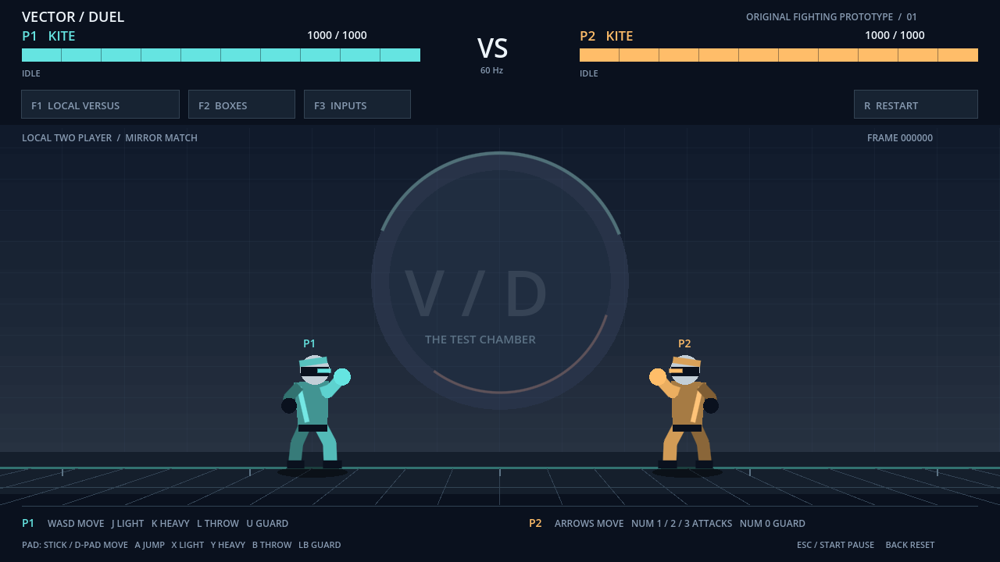

# Vector Duel / 横版一对一格斗

Godot **4.6.3 Standard** 的原创本地格斗原型，目标平台为 **Windows**。一个角色镜像对战、一个擂台，角色与场景均由简单几何形体绘制，无外部美术资产。



## 已实现

- 本地双人和训练模式，键盘与手柄输入。
- 移动、跳跃、蹲下、轻重攻击、低段与空中攻击、防御、投技和拆投。
- 确认命中后的轻击接重击短连段、KO、重赛；训练 KO 后自动重置。
- 固定 60 Hz 战斗逻辑，生命条、状态与招式阶段、连击数。
- 输入历史、攻击框、受击框、投技框和推挤框显示。

联网、CPU 对战、正式美术和 Windows 可执行文件发布不在本次交付中。此版本通过 Godot 运行源码；Linux 自动检查和实际渲染已完成，Windows 实机与实体手柄验收仍待本地执行。

## 拉取与运行

本地需要 Git 和 Godot 4.6.3 Standard，不需要额外插件或后台服务。

```sh
git clone https://github.com/TIAN-sign/re02.git fighter
cd fighter
git rev-parse HEAD
```

在 Godot 项目管理器中导入根目录 `project.godot`，按 **F5** 运行。命令行也可执行：

```sh
godot --path .
```

如果 Godot 未加入 PATH，请按 [Windows 审核说明](docs/windows-review.md) 使用完整引擎路径。固定审核版本时，先核对交付记录中的完整 commit SHA，再执行 `git switch --detach <完整SHA>`。后续在工作区干净时使用 `git pull --ff-only origin main` 更新主分支；先保存自己的修改，不用 ZIP 覆盖项目。

## 操作

| 操作 | P1 键盘 | P2 键盘 | 手柄 |
| --- | --- | --- | --- |
| 移动、跳跃、蹲下 | WASD | 方向键 | 左摇杆 / 方向键，南侧 A 跳跃 |
| 轻击、重击、投技 | J / K / L | 小键盘 1 / 2 / 3 | 西侧 X / 北侧 Y / 东侧 B |
| 防御 | U | 小键盘 0 | 左肩键 LB |

F1 切换训练，F2 判定框，F3 输入历史，F4 假人模式，R 重赛，Escape 暂停。手柄 Start 暂停、Back 重赛。前两个连接的手柄依次对应 P1/P2；键盘同时可用。顶部模式与显示按钮也可点击。

站立轻击命中后及时按重击可衔接两击；下方向加轻/重击为低段，空中攻击为中段。低段需蹲防，空中攻击需站防；近身投技可在捕获初期按投技键拆投。完整帧数见 [战斗规则](combat/README.md)。

## 检查与证据

Python 3 可选，仅用于统一运行检查：

```sh
python3 tests/run_checks.py --godot godot
```

检查包含 Godot 导入、战斗模块、输入训练、真实 InputMap 物理帧、完整场景整合及启动。CI 下载固定版本的官方 Godot 二进制并核验 SHA-256；不依赖本地生成缓存。

- [Windows 操作与人工验收清单](docs/windows-review.md)
- [真实渲染截图与验证边界](docs/evidence/README.md)
- [项目范围](docs/project-scope.md) · [接口契约](docs/interface-contract.md)
- [协作与交付约定](docs/collaboration.md) · [代理约定](AGENTS.md)
- [输入与训练说明](input/README.md)

输入历史记录的是训练假人覆盖前的输入，不等同于完整训练对局回放。所有开发以本仓库和可核对的 Git 提交为准。原有 `diyide` 测试文件保留原字节，不作为游戏入口。
